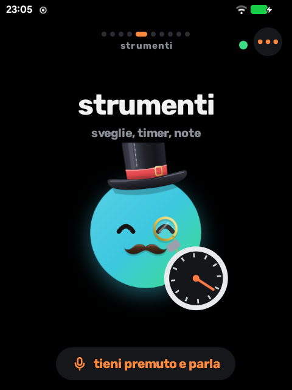
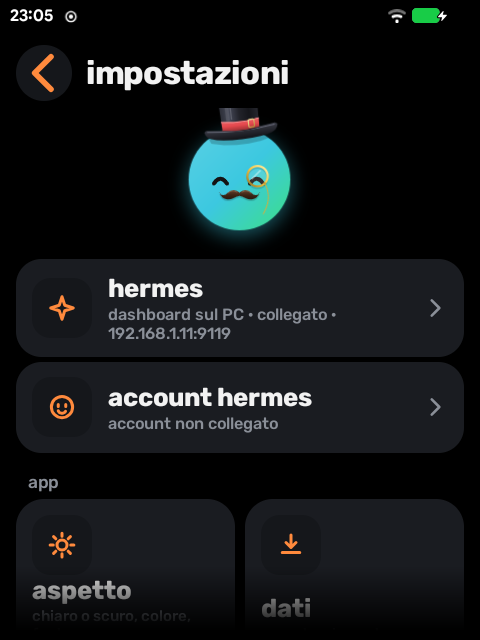
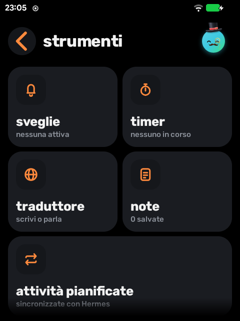

# R1 Agents

**Un launcher agente-centrico per Rabbit R1 (Android).** Il tuo agente AI è la schermata iniziale: lo parli, lo scorri, gli chiedi di aprire app, impostare timer o prendere note. Con integrazione profonda per Hermes e per Android, pensato per lo schermo 480×640 con rotella e touch. Interfaccia in italiano e inglese.

<p>
  
</p>
<p>
 
</p>

## Cosa fa
- **Launcher:** si sceglie come schermata iniziale (non si imposta da sola); cassetto app con ricerca, preferiti e recenti; «apri <app>» anche in chat.
- **Carosello orizzontale:** il buddy mostra l'oggetto di ogni funzione (fotocamera, controlli Android, strumenti, traduttore, note, competenze e attività di Hermes).
- **Hermes:** chat dal vivo con più agenti, stato «sta lavorando» sulla home, routine e competenze come pagine dedicate.
- **L'agente agisce sul dispositivo:** direttive `[[r1:kind=arg]]` per aprire app, timer, sveglie, note e pannelli di sistema, in modalità «chiedi», «automatiche» o «spente».
- **Android:** pagina Controlli (rete, bluetooth, batteria, spazio), «invia a…» dal menu di selezione testo di qualunque app, doppia pressione del tasto laterale per parlare senza tenere premuto.
- **Buddy animato:** reazioni, entrate e uscite, a riposo quasi a costo zero di CPU.

## Installazione
1. Scarica `r1agents-release-signed.apk` dall'ultima [release](https://github.com/Syax89/r1-agents/releases/latest) e installala sul Rabbit.
2. Per ricevere gli aggiornamenti: in *Impostazioni* inserisci come indirizzo del file `update.json`:
   `https://raw.githubusercontent.com/Syax89/r1-agents/main/update.json`

## Sviluppo
Kotlin con View programmatiche, nessuna dipendenza UI esterna. Build e prove:
```bash
tools/check.sh --copy          # test unitari, lint, APK di rilascio
tools/device-check.sh <serial> # suite di prova sul dispositivo (pacchetto QA isolato)
tools/perf.py --serial <serial> # misure di prestazioni
```
Per riprendere il lavoro: [HANDOVER.md](HANDOVER.md) (stato e comandi), [ROADMAP.md](ROADMAP.md), [VERIFICATION.md](VERIFICATION.md), [DESIGN.md](DESIGN.md), [CHANGELOG.md](CHANGELOG.md).

La chiave di firma non fa parte del repository.
