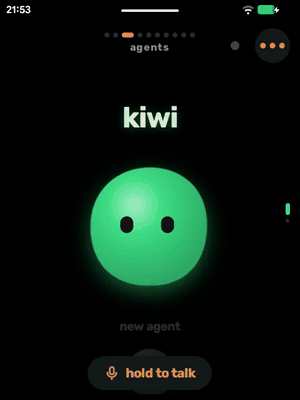
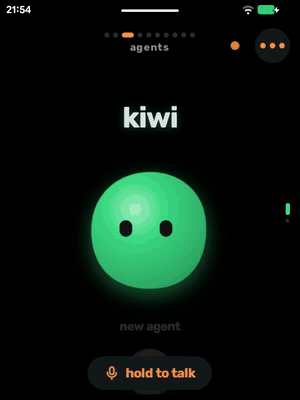
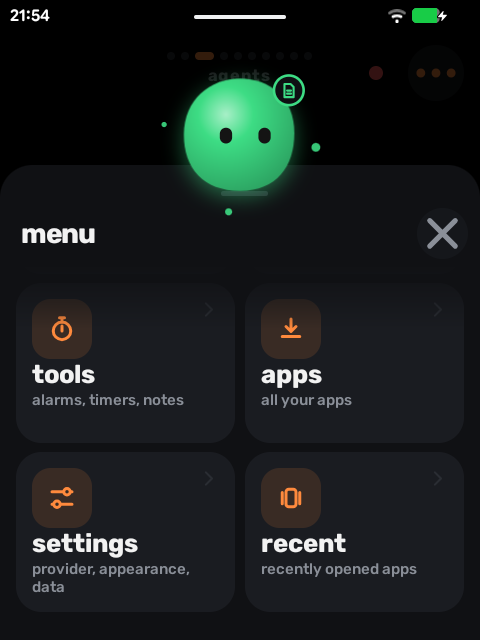
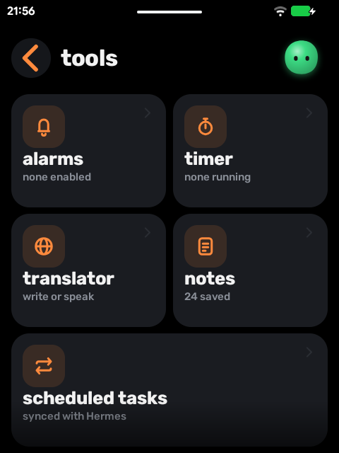
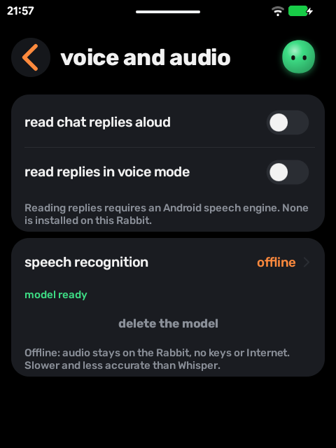
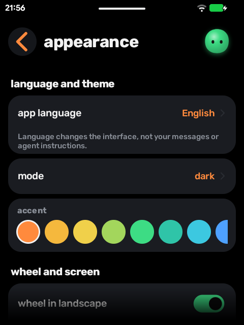

<div align="center">

# R1 Agents

**An agent-first launcher for the Rabbit R1.**
Your AI agent *is* the home screen: talk to it, scroll through it, let it open apps, set timers and take notes.

[](https://github.com/Syax89/r1-agents/releases/latest)


&nbsp;&nbsp;
&nbsp;&nbsp;


</div>

---

## Why

The Rabbit R1 runs Android underneath, but its tiny 480×640 screen, scroll wheel and side button don't fit a phone launcher. R1 Agents replaces the home screen with something built for that hardware: one big animated **buddy** per agent, a horizontal carousel of features, push-to-talk everywhere, and an agent that can actually *do* things on the device.

It works with your own API keys (Anthropic, OpenAI, Groq, any OpenAI-compatible server) or connects live to a [Hermes](https://github.com/NousResearch/hermes-agent) agent running on your PC.

## Highlights

| | |
|---|---|
| 🟢 **Agent as home screen** | Each agent is a buddy you swipe between. Tap to chat, hold the button to talk. A live status dot shows when Hermes is working. |
| 🎠 **Feature carousel** | Swipe sideways (or turn the wheel) for camera, tools, translator, Android controls, notes, skills and scheduled tasks. The buddy swaps the object it's holding. |
| 🎙️ **Push-to-talk on the side button** | Long-press the side button to open the voice screen and start listening; it sends when you stop talking. Press again to keep the conversation going. |
| 🗣️ **Choose your speech recognition** | Groq Whisper, any Whisper-compatible server, Hermes itself, or **fully offline** with Vosk: audio never leaves the Rabbit. |
| 🤖 **The agent acts on the device** | Open apps, set timers and alarms, toggle the torch, write notes, open system panels. Each action can ask first, run automatically, or be off, and everything is logged. |
| 🕰️ **Standby clock** | When the screen goes off, a glance clock shows over the lock screen. While charging it stays on at low brightness, like a bedside clock. |
| 🔐 **Private by default** | Keys are stored encrypted, PIN lock per chat, secure flag on sensitive screens, phone context and notifications off until you turn them on. |
| 🚀 **Smooth on modest hardware** | Static buddy layers live on the GPU, so an idle home costs almost no CPU; scrolling and page transitions are tuned for the R1's PowerVR GPU. |

<p align="center">





</p>

## Install

> [!TIP]
> **Recommended base: the [haretic](https://github.com/haretic) firmware.** It is a LineageOS build for the Rabbit R1 on a mainline kernel, with its own [installer](https://github.com/haretic/installer) and [flashable images](https://github.com/haretic/release). It's an excellent foundation, and it's the Android build we develop and test R1 Agents on.

1. Download `r1agents-release-signed.apk` from the [latest release](https://github.com/Syax89/r1-agents/releases/latest).
2. Install it on the Rabbit (`adb install r1agents-release-signed.apk`, or open the file on the device).
3. Optional: choose **R1 Agents** as the home app when Android asks. It never sets itself as the home app.
4. Updates arrive in the app from this repository's [`update.json`](update.json). Before installing anything, the app checks the SHA-256, the package, the version and the signing certificate.

### Side button setup

On the R1, the side button is Android's power key, so apps can't read it directly. R1 Agents uses the long press instead:

1. **Settings → side button → make R1 Agents the assistant** (Android asks you to confirm).
2. In Android's power-button settings, set *press and hold* to **digital assistant**.
3. Pick what the button does: voice (default), latest chat, recent apps, torch or clock.

## Under the hood

- **Kotlin with programmatic Views** and no UI framework dependencies. Every animation is hand-tuned for a 480×640 screen.
- **Providers:** Anthropic and OpenAI-compatible chat engines with tool use. Hermes runs over its dashboard WebSocket with live sessions, approvals, skills and cron jobs.
- **Voice:** a `Mic` abstraction over Whisper (HTTP), Hermes transcription, Vosk offline, and Android `SpeechRecognizer`.
- **Assistant integration:** a `VoiceInteractionService` and a recognition service stub, so the side button's long press reaches the app.
- **i18n:** every string goes through a generated catalog. English and Italian are complete.

## Development

```bash
tools/check.sh --copy                             # unit tests, lint, release APK
tools/device-check.sh <serial> --all-suites       # on-device suites on an isolated QA package
tools/perf.py --serial <serial>                   # frame-time and CPU measurements
```

Device tests run on a separate `dev.r1agents.qa` package with a mock Hermes server, so they never touch your real chats.

More docs (in Italian): [HANDOVER.md](HANDOVER.md) (status and commands), [ROADMAP.md](ROADMAP.md), [DESIGN.md](DESIGN.md), [VERIFICATION.md](VERIFICATION.md), [CHANGELOG.md](CHANGELOG.md).

## Credits

The design and the buddy characters build on **r1os** (MIT). R1 Agents is an independent project and is not affiliated with Rabbit Inc.

The signing key is not part of this repository.
